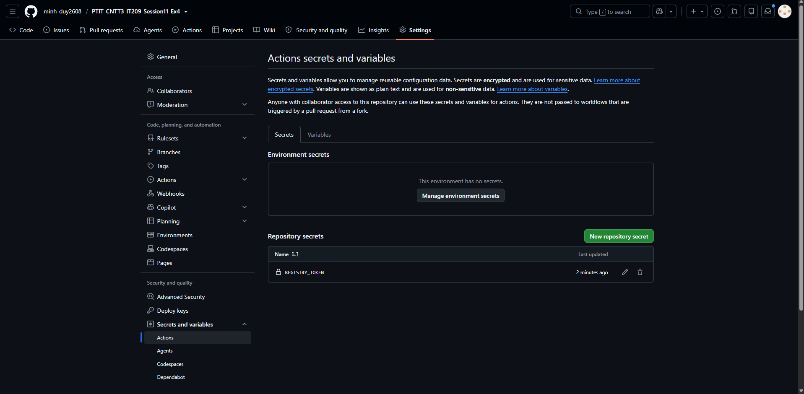

# Bài 4: Khai báo GitHub Secrets và cấu hình Đăng nhập Container Registry

## 1. Mục tiêu
- Tạo tệp mã hóa an toàn (**Repository Secret**) lưu trữ Token cá nhân trên GitHub.
- Cấu hình bước xác thực đăng nhập tự động vào **GitHub Container Registry (GHCR)**.

---

## 2. Các bước thực hiện chi tiết

### Bước 1: Tạo Personal Access Token (classic) trên GitHub
1. Đăng nhập vào GitHub, bấm vào ảnh đại diện góc trên bên phải $\rightarrow$ chọn **Settings**.
2. Cuộn xuống cuối thanh menu bên trái, chọn **Developer settings**.
3. Chọn **Personal access tokens** $\rightarrow$ chọn **Tokens (classic)**.
4. Bấm **Generate new token** $\rightarrow$ chọn **Generate new token (classic)**.
5. Điền thông tin:
   - **Note**: `REGISTRY_TOKEN` (hoặc tên gợi nhớ như `GHCR_TOKEN`).
   - **Expiration**: Chọn thời hạn phù hợp (ví dụ: 30 days hoặc 90 days).
   - **Select scopes**: Tích chọn quyền **`write:packages`** (hệ thống sẽ tự động tích thêm `read:packages`).
6. Bấm nút xanh **Generate token** ở cuối trang.
7. **Lưu ý**: Sao chép (copy) chuỗi token vừa sinh ra (dạng `ghp_...`). *Token chỉ hiển thị một lần duy nhất!*

---

### Bước 2: Khai báo Repository Secret trên GitHub
1. Truy cập vào Repository của bạn trên GitHub.
2. Vào tab **Settings** $\rightarrow$ menu bên trái chọn **Secrets and variables** $\rightarrow$ chọn **Actions**.
3. Bấm nút **New repository secret**.
4. Điền thông tin:
   - **Name**: `REGISTRY_TOKEN` *(chính xác tên này)*.
   - **Secret**: Dán token bạn vừa sao chép ở Bước 1.
5. Bấm **Add secret**.



---

### Bước 3: Cấu hình workflow `.github/workflows/ci.yml`
File workflow đã được tạo tại [.github/workflows/ci.yml](.github/workflows/ci.yml):

```yaml
name: CI Pipeline

on:
  push:
    branches: [ "main", "master" ]
  pull_request:
    branches: [ "main", "master" ]
  workflow_dispatch:

jobs:
  docker-login:
    name: Build & Login Registry
    runs-on: ubuntu-latest
    steps:
      - name: Checkout mã nguồn
        uses: actions/checkout@v4

      - name: Đăng nhập vào GitHub Container Registry
        uses: docker/login-action@v3
        with:
          registry: ghcr.io
          username: ${{ github.actor }}
          password: ${{ secrets.REGISTRY_TOKEN }}
```

---

### Bước 4: Khởi tạo Git và Đẩy code lên GitHub
Chạy các lệnh sau trong terminal để đẩy code lên repository của bạn:
```bash
git init
git add .
git commit -m "feat: setup ci workflow with ghcr login action"
git branch -M main
git remote add origin <URL_REPOSITORY_CUA_BAN>
git push -u origin main
```

---

### Bước 5: Kiểm tra kết quả
1. Vào tab **Actions** trên GitHub repository.
2. Bấm vào lượt chạy workflow mới nhất (**CI Pipeline**).
3. Bấm vào job **Build & Login Registry**.
4. Mở chi tiết bước **Đăng nhập vào GitHub Container Registry**.
5. Xác nhận log kết quả hiển thị dòng:
   ```text
   Login Succeeded
   ```

---

## 3. Sản phẩm nộp bài
1. Tệp kịch bản [.github/workflows/ci.yml](.github/workflows/ci.yml) (có bước `docker/login-action@v3`).
2. Ảnh chụp màn hình mục **Repository Secrets** hiển thị biến `REGISTRY_TOKEN` đã khởi tạo.
